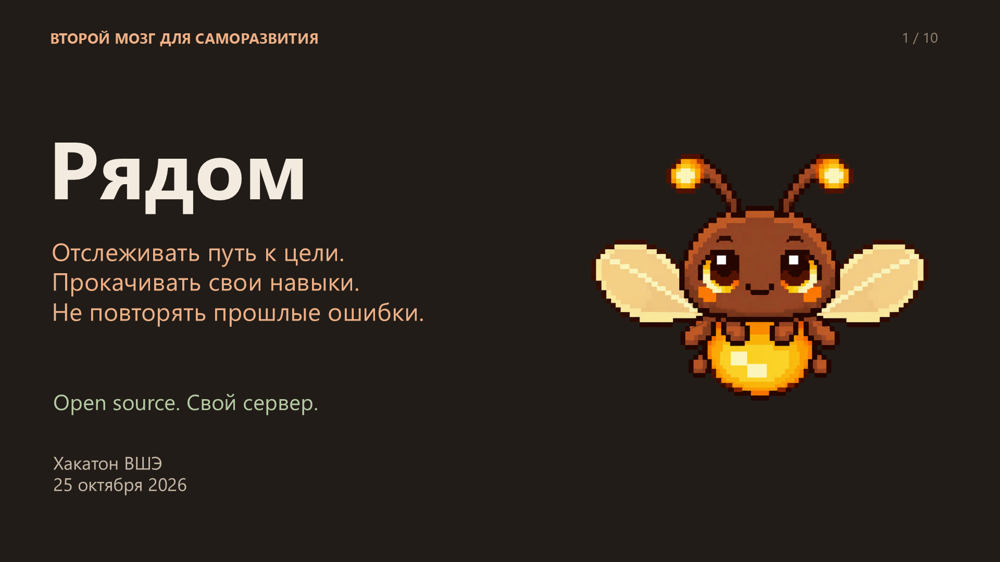
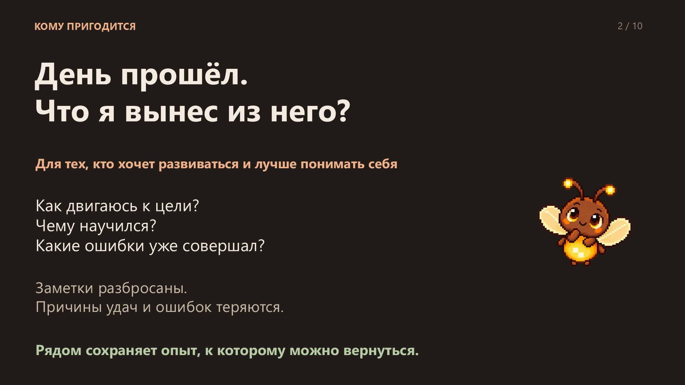
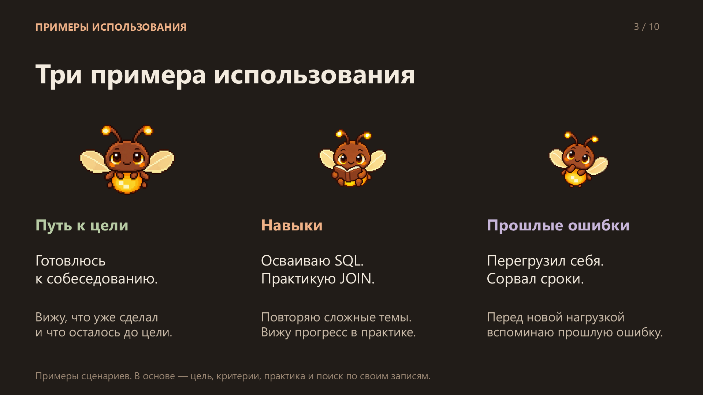
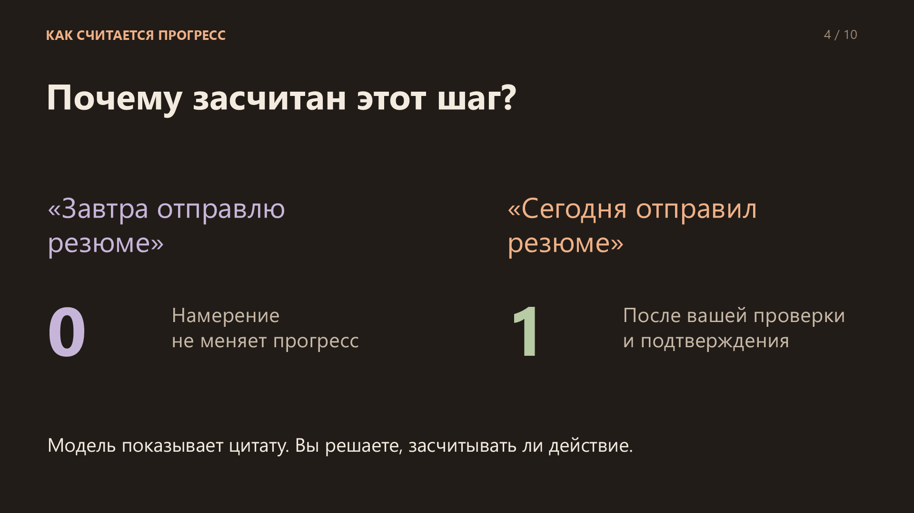
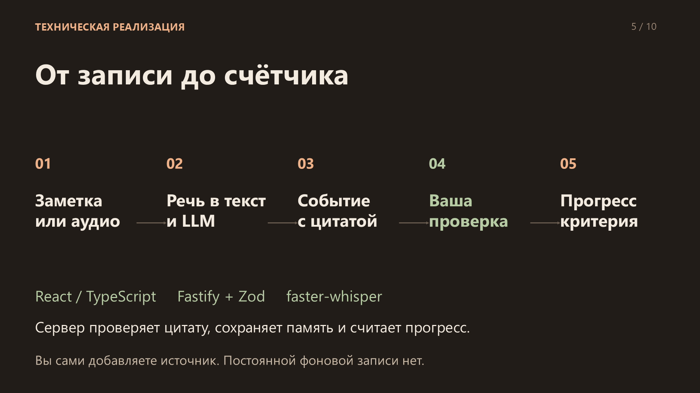
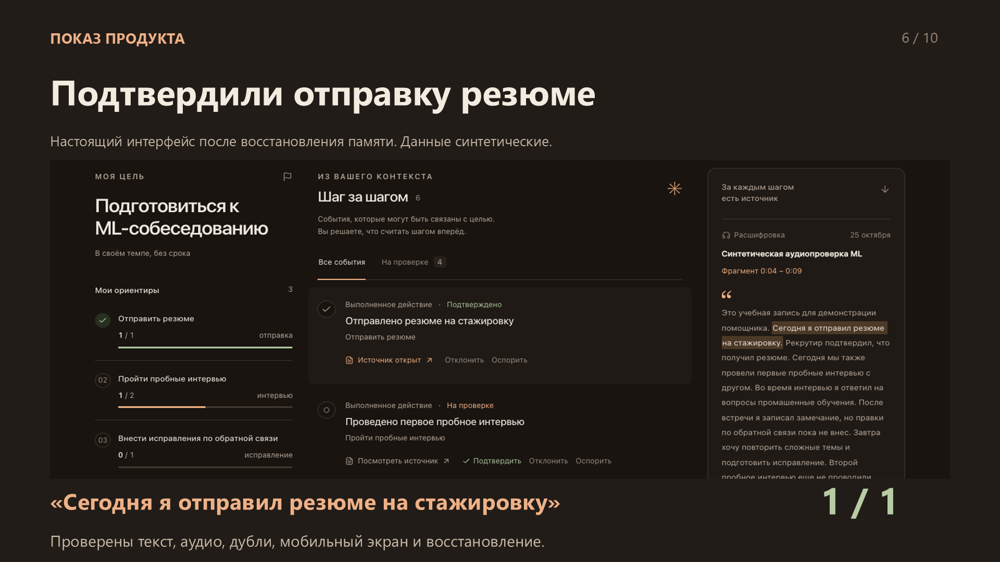
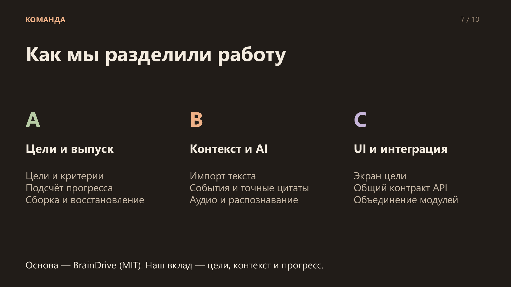
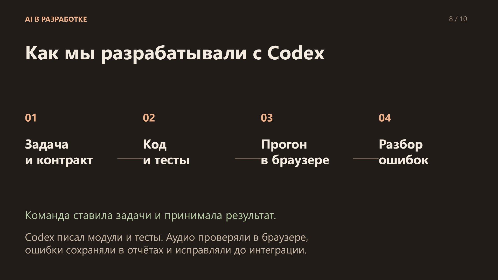
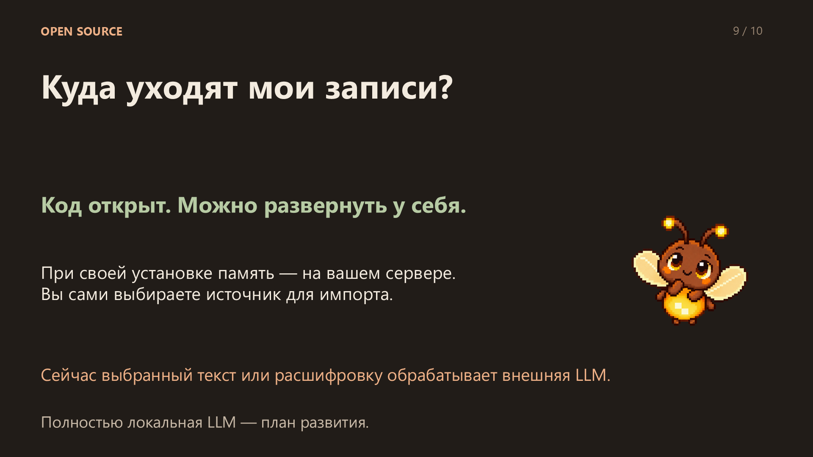
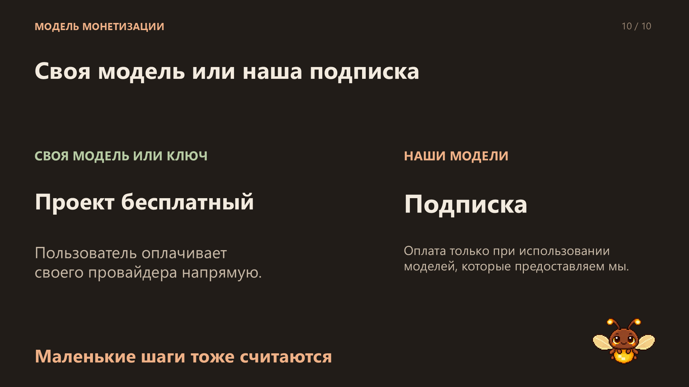

# Рядом — презентация для защиты

Второй мозг для саморазвития: отслеживать путь к цели, прокачивать навыки и помнить прошлые ошибки, чтобы не повторять их.

**[Открыть PDF — 10 слайдов](ryadom-pitch.pdf)** · **[Скачать PowerPoint с анимацией](https://raw.githubusercontent.com/Mozgiii9/vibecoding-hackathon-hse/refs/heads/codex/pitch-public/docs/pitch/ryadom-pitch.pptx)** · **[Анимация обложки — MP4](https://raw.githubusercontent.com/Mozgiii9/vibecoding-hackathon-hse/refs/heads/codex/pitch-public/docs/pitch/cover-animation.mp4)**

PDF и изображения ниже показывают статичные слайды. В PowerPoint светлячок шевелит крыльями и плавно парит; короткое видео показывает эту анимацию.

Хакатон ВШЭ, 25 октября 2026. Скриншот продукта использует синтетические данные. Примеры трёх направлений иллюстрируют сценарии использования, а не результаты исследования эффективности.
